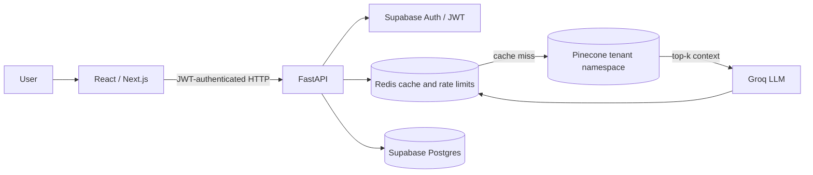

# Ragbase

**A multi-tenant RAG platform for uploading knowledge and asking grounded questions through a React interface and FastAPI API.**

[](https://github.com/mariamneffeti/ragbase/actions/workflows/ci.yml)
[](https://www.python.org/)
[](https://nodejs.org/)
[](LICENSE)
[](https://ragbase-2rlwe8dyg-mariamneffetis-projects.vercel.app)

## Demo

<!-- Add docs/demo.gif (or update this path) when the product capture is ready. -->


[Open the live demo](https://ragbase-2rlwe8dyg-mariamneffetis-projects.vercel.app).

## Features

- Supabase passwordless authentication and backend JWT verification.
- Tenant-scoped document upload, listing, and deletion.
- PDF, DOCX, CSV, Markdown, and text extraction with chunking and embeddings.
- Retrieval-augmented chat using Pinecone context and Groq generation.
- Redis response caching and per-tenant request rate limits.
- Async FastAPI routes and background-friendly document processing.
- File type validation, request limits, and container health checks.
- Next.js dashboard for document management and chat.

Chat currently returns a complete JSON answer; token-by-token streaming is on the roadmap.

## Architecture



The current backend uses Supabase for identity validation; its main document retrieval path stores vectors and text metadata in Pinecone. Redis backs chat caching and rate limiting. Supabase Postgres is managed by the Supabase project rather than accessed directly by the backend's current request handlers.

## Stack

| Area | Technology |
| --- | --- |
| Frontend | React, Next.js, TypeScript, Supabase Auth |
| API | Python, FastAPI, Pydantic |
| Authentication | Supabase JWTs, PyJWT/JWKS verification |
| Vector search and embeddings | Pinecone |
| LLM | Groq |
| Cache and rate limiting | Redis |
| Managed identity/database | Supabase Auth and Postgres |
| Local runtime | Docker, Docker Compose |

## Quickstart

### Docker (recommended)

Requirements: Docker Compose and provider credentials for Supabase, Pinecone, and Groq.

```bash
cp backend/.env.example backend/.env
# Edit backend/.env and set SUPABASE_URL, PINECONE_API_KEY, and GROQ_API_KEY.
docker compose up --build
```

The API is available at `http://localhost:8000`; with `DEBUG=true`, interactive docs are at `http://localhost:8000/docs`. Start the frontend in a second terminal:

```bash
cd frontend
npm install
cp .env.local.example .env.local
# Set the Supabase frontend values and NEXT_PUBLIC_API_URL=http://localhost:8000.
npm run dev
```

### Manual backend setup

Requirements: Python 3.11+, Node.js 18+, and a running Redis instance. Set backend values as above; set `REDIS_URL` to your Redis URL.

```bash
cd backend
python -m venv .venv
# Activate .venv for your shell, then:
pip install -r requirements.txt
python -m uvicorn app.main:app --reload
```

Then run the frontend using the commands in the Docker section. The frontend environment template is `frontend/.env.local.example`.

## API Endpoints

All application routes are under `/api/v1`. Protected routes require `Authorization: Bearer <supabase-jwt>`.

| Method | Path | Purpose | Success |
| --- | --- | --- | --- |
| GET | `/health` | API and Redis health | `200` |
| POST | `/api/v1/documents/upload` | Upload and ingest a supported file | `202` |
| POST | `/api/v1/documents/ingest/text` | Ingest raw text and index chunks | `201` |
| GET | `/api/v1/documents/list` | List the caller's documents | `200` |
| DELETE | `/api/v1/documents/{document_id}` | Delete a document from the caller's namespace | `204` |
| POST | `/api/v1/chat/query` | Retrieve context and generate an answer | `200` |

## Multi-tenancy

The backend validates the bearer token against Supabase's JWKS and derives the tenant from the JWT `app_metadata.tenant_id`, falling back to the authenticated subject. Pinecone operations use that tenant ID as the namespace for writes, searches, listings, and deletions. The client-supplied `X-Tenant-ID` header is not the source of tenant identity. Chat cache keys also include the verified tenant ID so answers are not shared across tenants.

## Testing

Tests use `pytest`, fake Redis, and mocked vector/embedding/LLM services. They do not require provider keys or make real API calls.

```bash
cd backend
pip install -r requirements.txt
pytest
```

GitHub Actions runs the backend suite on pushes and pull requests.

## Project Structure

```text
.
├── backend/
│   ├── app/api/                 # FastAPI routes and auth dependencies
│   ├── app/core/                # Settings and Redis rate limiter
│   ├── app/services/            # Pinecone and LLM integrations
│   ├── app/tasks/               # Document ingestion and reconciliation
│   ├── app/utils/               # File validation
│   └── tests/                   # Unit and API integration tests
├── frontend/                    # Next.js application
├── .github/workflows/ci.yml     # Backend test workflow
├── docker-compose.yml           # Local API and Redis services
└── README.md
```

## Key Technical Decisions

- **Tenant isolation:** derive identity from a verified JWT and pass it as the Pinecone namespace on every vector operation.
- **Caching:** cache generated answers in Redis for one hour using a SHA-256 hash of the question and the tenant ID; rate limits use tenant-scoped Redis keys.
- **Authentication:** validate Supabase JWT signature, issuer, audience, expiry, and allowed signing algorithm with JWKS keys.
- **Chunking:** uploaded files use character chunks (1,000 characters with 200 overlap); raw text ingestion uses 250-word chunks with 50-word overlap.
- **Retrieval:** embed the question, retrieve up to five matches from the tenant namespace, and pass their context to the LLM.
- **Failure handling:** translate upstream vector, LLM, and rate-limit failures into API responses rather than returning provider internals.

## Results / Benchmarks

| Metric | Result |
| --- | --- |
| Retrieval latency (p50 / p95) | TBD |
| End-to-end answer latency (p50 / p95) | TBD |
| Retrieval quality (evaluation set) | TBD |
| Cache hit rate | TBD |

## Roadmap

- Add token-by-token chat streaming.
- Add a repeatable retrieval quality and latency evaluation set.
- Add production deployment and observability guidance.
- Capture and publish a product demo GIF.

## License

MIT. See [LICENSE](LICENSE).

## Contact

Created by [Mariam Neffeti](https://github.com/mariamneffeti). For questions or opportunities, open a GitHub issue or reach out through the profile.
